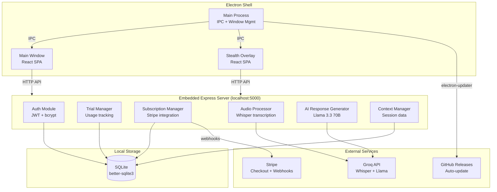
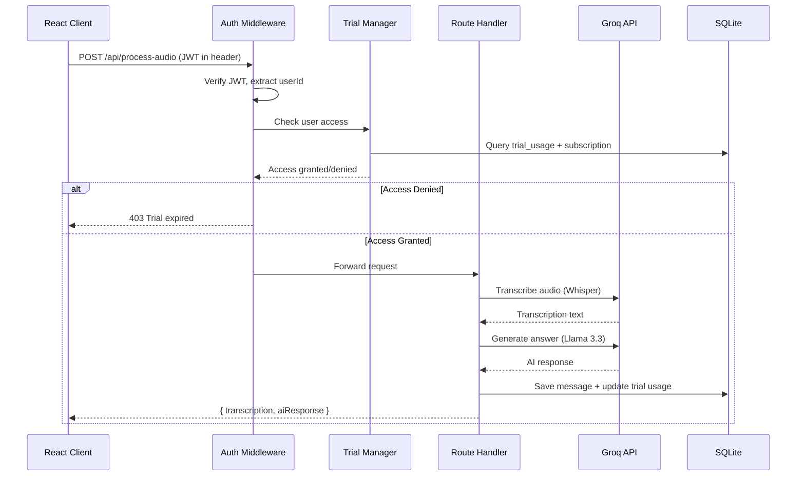
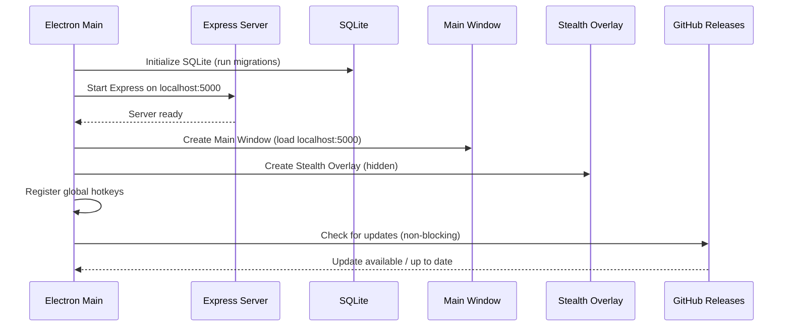

# Design Document: Interview Copilot MVP

## Overview

Interview Copilot MVP is a self-contained Electron desktop application that bundles a React frontend, Express.js backend, and SQLite database into a single distributable package. The app captures system audio from browser-based meeting tabs, transcribes interviewer questions via Groq Whisper, and generates context-aware answer suggestions using Groq Llama 3.3 70B. Revenue comes from a freemium model: 1-hour accumulated audio trial followed by a $19-29/month Stripe subscription.

### Design Goals

- **Zero infrastructure cost**: All components run locally; only external calls are Groq API and Stripe webhooks
- **Single-binary distribution**: Electron bundles the entire stack, updatable via GitHub Releases
- **Server-side enforcement**: Trial and subscription checks happen in the Express backend, not the client
- **Privacy-first**: All user data stays on the local machine; no cloud storage except API calls to Groq and Stripe

### Key Technical Decisions

| Decision | Choice | Rationale |
|----------|--------|-----------|
| Database | SQLite via better-sqlite3 | Zero-config, embedded, fast for single-user workloads |
| ORM | Drizzle ORM (SQLite driver) | Already in project, type-safe, supports SQLite |
| Auth | JWT (access + refresh tokens) | Stateless verification, works offline after login |
| Payments | Stripe Checkout + Webhooks | Hosted payment page, no PCI scope |
| AI Provider | Groq free tier | Free Whisper transcription + Llama 3.3 70B chat |
| Auto-update | electron-updater + GitHub Releases | Free distribution, no paid CDN |
| State management | TanStack Query + React Context | Already in project, handles server state well |

## Architecture

### System Architecture Diagram



### Request Flow



### Startup Sequence



## Components and Interfaces

### Server-Side Components

#### Auth Module (`server/auth/`)

```typescript
// server/auth/middleware.ts
interface AuthMiddleware {
  authenticate: (req: Request, res: Response, next: NextFunction) => void;
  optionalAuth: (req: Request, res: Response, next: NextFunction) => void;
}

// server/auth/service.ts
interface AuthService {
  register(email: string, password: string): Promise<{ user: User; tokens: TokenPair }>;
  login(email: string, password: string): Promise<{ user: User; tokens: TokenPair }>;
  refresh(refreshToken: string): Promise<{ accessToken: string }>;
  logout(userId: number, refreshToken: string): Promise<void>;
}

interface TokenPair {
  accessToken: string;   // JWT, 15-min expiry
  refreshToken: string;  // opaque token, 7-day expiry, stored in DB
}
```

#### Trial Manager (`server/trial/`)

```typescript
interface TrialManager {
  checkAccess(userId: number): Promise<AccessResult>;
  recordUsage(userId: number, durationSeconds: number): Promise<void>;
  getRemainingTime(userId: number): Promise<number>; // seconds remaining
}

interface AccessResult {
  allowed: boolean;
  reason?: 'trial_active' | 'subscribed' | 'grace_period';
  denyReason?: 'trial_expired' | 'subscription_inactive';
  remainingSeconds?: number;
}
```

#### Subscription Manager (`server/subscription/`)

```typescript
interface SubscriptionManager {
  createCheckoutSession(userId: number): Promise<{ url: string }>;
  handleWebhook(event: Stripe.Event): Promise<void>;
  getStatus(userId: number): Promise<SubscriptionStatus>;
}

interface SubscriptionStatus {
  active: boolean;
  plan?: string;
  currentPeriodEnd?: Date;
  gracePeriodEnd?: Date;
}
```

#### Audio Processor (`server/audio/`)

```typescript
interface AudioProcessor {
  transcribe(audioBuffer: Buffer, mimeType: string): Promise<string>;
  filterFiller(text: string): boolean; // true if filler/noise
}
```

#### AI Response Generator (`server/ai/`)

```typescript
interface AIResponseGenerator {
  generateResponse(params: GenerateParams): Promise<string>;
  detectInterviewType(transcription: string, context: string): InterviewType;
  findCachedResponse(question: string, sessionId: number): Promise<string | null>;
}

interface GenerateParams {
  transcription: string;
  sessionContext: SessionContext;
  conversationMemory: ConversationMemory;
  interviewType: InterviewType;
}

interface ConversationMemory {
  rollingSummary: string;       // Summary of older exchanges
  recentExchanges: Exchange[];  // Last 5 Q&A pairs in full
}
```

#### Context Manager (`server/context/`)

```typescript
interface ContextManager {
  createSession(userId: number, data: SessionInput): Promise<Session>;
  updateSession(sessionId: number, data: Partial<SessionInput>): Promise<Session>;
  getSession(sessionId: number): Promise<Session>;
  listSessions(userId: number): Promise<Session[]>;
  parseResume(file: Buffer, mimeType: string): Promise<string>;
}

interface SessionInput {
  companyName: string;
  jobDescription: string;
  resumeText: string;
  skills: string[];
  notes: string;
}
```

### Client-Side Components

#### Auth State (`client/src/hooks/use-auth.ts`)

```typescript
interface AuthState {
  user: User | null;
  isAuthenticated: boolean;
  isLoading: boolean;
  login: (email: string, password: string) => Promise<void>;
  register: (email: string, password: string) => Promise<void>;
  logout: () => Promise<void>;
}
```

#### Trial Display (`client/src/hooks/use-trial.ts`)

```typescript
interface TrialState {
  remainingSeconds: number;
  isTrialActive: boolean;
  isSubscribed: boolean;
  isGracePeriod: boolean;
  refreshStatus: () => Promise<void>;
}
```

### Electron IPC Interface

```typescript
// Channels: Main → Renderer
interface MainToRenderer {
  'auth:token-refreshed': { accessToken: string };
  'update:available': { version: string };
  'update:downloaded': void;
  'overlay:toggle': void;
}

// Channels: Renderer → Main
interface RendererToMain {
  'auth:store-tokens': TokenPair;
  'auth:get-tokens': void;
  'auth:clear-tokens': void;
  'update:install': void;
  'window:minimize': void;
  'window:close': void;
}
```

## Data Models

### SQLite Schema

```mermaid
erDiagram
    users {
        integer id PK
        text email UK
        text password_hash
        text created_at
        text updated_at
    }

    refresh_tokens {
        integer id PK
        integer user_id FK
        text token UK
        text expires_at
        integer revoked
        text created_at
    }

    trial_usage {
        integer id PK
        integer user_id FK UK
        real used_seconds
        real total_allowed_seconds
        text last_updated
    }

    subscriptions {
        integer id PK
        integer user_id FK UK
        text stripe_customer_id
        text stripe_subscription_id UK
        text status
        text plan
        text current_period_end
        text grace_period_end
        text created_at
        text updated_at
    }

    sessions {
        integer id PK
        integer user_id FK
        text company_name
        text job_description
        text resume_text
        text skills_json
        text notes
        integer is_active
        text created_at
        text updated_at
    }

    messages {
        integer id PK
        integer session_id FK
        integer user_id FK
        text transcription
        text ai_response
        text interview_type
        real audio_duration_seconds
        text created_at
    }

    users ||--o{ refresh_tokens : has
    users ||--|| trial_usage : has
    users ||--o| subscriptions : has
    users ||--o{ sessions : owns
    sessions ||--o{ messages : contains
```

### Drizzle Schema Definition

```typescript
// shared/schema.ts
import { sqliteTable, text, integer, real } from 'drizzle-orm/sqlite-core';
import { sql } from 'drizzle-orm';

export const users = sqliteTable('users', {
  id: integer('id').primaryKey({ autoIncrement: true }),
  email: text('email').notNull().unique(),
  passwordHash: text('password_hash').notNull(),
  createdAt: text('created_at').default(sql`(datetime('now'))`),
  updatedAt: text('updated_at').default(sql`(datetime('now'))`),
});

export const refreshTokens = sqliteTable('refresh_tokens', {
  id: integer('id').primaryKey({ autoIncrement: true }),
  userId: integer('user_id').notNull().references(() => users.id),
  token: text('token').notNull().unique(),
  expiresAt: text('expires_at').notNull(),
  revoked: integer('revoked', { mode: 'boolean' }).default(false),
  createdAt: text('created_at').default(sql`(datetime('now'))`),
});

export const trialUsage = sqliteTable('trial_usage', {
  id: integer('id').primaryKey({ autoIncrement: true }),
  userId: integer('user_id').notNull().references(() => users.id).unique(),
  usedSeconds: real('used_seconds').default(0),
  totalAllowedSeconds: real('total_allowed_seconds').default(3600), // 1 hour
  lastUpdated: text('last_updated').default(sql`(datetime('now'))`),
});

export const subscriptions = sqliteTable('subscriptions', {
  id: integer('id').primaryKey({ autoIncrement: true }),
  userId: integer('user_id').notNull().references(() => users.id).unique(),
  stripeCustomerId: text('stripe_customer_id'),
  stripeSubscriptionId: text('stripe_subscription_id').unique(),
  status: text('status').notNull().default('inactive'), // active | inactive | past_due | canceled
  plan: text('plan').default('monthly'),
  currentPeriodEnd: text('current_period_end'),
  gracePeriodEnd: text('grace_period_end'),
  createdAt: text('created_at').default(sql`(datetime('now'))`),
  updatedAt: text('updated_at').default(sql`(datetime('now'))`),
});

export const sessions = sqliteTable('sessions', {
  id: integer('id').primaryKey({ autoIncrement: true }),
  userId: integer('user_id').notNull().references(() => users.id),
  companyName: text('company_name').default(''),
  jobDescription: text('job_description').default(''),
  resumeText: text('resume_text').default(''),
  skillsJson: text('skills_json').default('[]'), // JSON array of strings
  notes: text('notes').default(''),
  isActive: integer('is_active', { mode: 'boolean' }).default(true),
  createdAt: text('created_at').default(sql`(datetime('now'))`),
  updatedAt: text('updated_at').default(sql`(datetime('now'))`),
});

export const messages = sqliteTable('messages', {
  id: integer('id').primaryKey({ autoIncrement: true }),
  sessionId: integer('session_id').notNull().references(() => sessions.id),
  userId: integer('user_id').notNull().references(() => users.id),
  transcription: text('transcription').notNull(),
  aiResponse: text('ai_response').notNull(),
  interviewType: text('interview_type').default('general'),
  audioDurationSeconds: real('audio_duration_seconds').default(0),
  createdAt: text('created_at').default(sql`(datetime('now'))`),
});
```

### Key Data Relationships

- **User → Trial Usage**: 1:1. Created on registration. `used_seconds` accumulates across all sessions.
- **User → Subscription**: 1:0..1. Created when first Stripe checkout completes.
- **User → Sessions**: 1:many. Users can have multiple interview prep contexts.
- **Session → Messages**: 1:many. Each Q&A exchange is a message within a session.
- **User → Refresh Tokens**: 1:many. Multiple devices/logins can exist; revoked on logout.


## Correctness Properties

*A property is a characteristic or behavior that should hold true across all valid executions of a system — essentially, a formal statement about what the system should do. Properties serve as the bridge between human-readable specifications and machine-verifiable correctness guarantees.*

### Property 1: Password Registration Round-Trip

*For any* valid email and password, registering a user and then verifying the stored password hash with bcrypt.compare should return true, and the hash cost factor should be >= 10.

**Validates: Requirements 1.1**

### Property 2: Token Expiry Invariants

*For any* valid user login, the issued JWT access token should decode to reveal an expiry timestamp approximately 15 minutes from issuance, and the refresh token stored in the database should have an expiry approximately 7 days from issuance.

**Validates: Requirements 1.2**

### Property 3: Generic Auth Error on Invalid Credentials

*For any* login attempt with either a non-existent email or an incorrect password for an existing account, the returned error message should be identical ("invalid email or password") regardless of which field is wrong.

**Validates: Requirements 1.3**

### Property 4: Refresh Token Issues New Access Token

*For any* user with a valid, non-expired, non-revoked refresh token, calling the refresh endpoint should return a new valid JWT access token with fresh expiry.

**Validates: Requirements 1.4**

### Property 5: Logout Invalidates Refresh Token

*For any* user who logs out, attempting to use their previously valid refresh token should fail with an authentication error.

**Validates: Requirements 1.5**

### Property 6: Protected Routes Reject Invalid Tokens

*For any* protected API endpoint and any request missing a token, bearing an expired token, or bearing a malformed token, the response should be 401 Unauthorized.

**Validates: Requirements 1.6**

### Property 7: Duplicate Email Registration Rejected

*For any* email that has already been registered, a second registration attempt with that same email should fail with an "email already registered" error.

**Validates: Requirements 1.7**

### Property 8: New User Trial Initialization

*For any* newly registered user, their trial_usage record should show exactly 3600 total_allowed_seconds and 0 used_seconds.

**Validates: Requirements 2.1**

### Property 9: Trial Usage Additive Accumulation

*For any* sequence of audio processing requests with known durations [d1, d2, ..., dn], the user's used_seconds after all requests should equal the sum d1 + d2 + ... + dn.

**Validates: Requirements 2.2, 2.3, 2.6**

### Property 10: Exhausted Trial Blocks Audio Processing

*For any* user whose used_seconds >= total_allowed_seconds AND who has no active subscription AND is not in a grace period, audio processing requests should be rejected with a trial-expired error.

**Validates: Requirements 2.4**

### Property 11: Active Subscription Bypasses Trial

*For any* user with subscription status "active", audio processing should succeed regardless of trial usage (even if used_seconds >= total_allowed_seconds).

**Validates: Requirements 3.4**

### Property 12: Webhook Activates Subscription

*For any* valid checkout.session.completed webhook event referencing a registered user, after processing, the user's subscription status should be "active" with the correct Stripe customer and subscription IDs stored.

**Validates: Requirements 3.2, 3.6**

### Property 13: Webhook Deactivates Subscription

*For any* valid customer.subscription.deleted or invoice.payment_failed webhook event, after processing, the user's subscription status should be "inactive".

**Validates: Requirements 3.3**

### Property 14: Grace Period Access Window

*For any* user whose subscription status became "inactive" and whose grace_period_end is set, access should be allowed when current_time < grace_period_end and denied when current_time >= grace_period_end.

**Validates: Requirements 3.5**

### Property 15: Webhook Signature Verification

*For any* webhook request with an invalid Stripe signature, the webhook handler should reject the request without processing the event payload.

**Validates: Requirements 3.7**

### Property 16: Session Context Round-Trip

*For any* valid session input (company name, job description, resume text, skills list, notes), creating a session and then retrieving it should return identical field values.

**Validates: Requirements 4.1, 4.3**

### Property 17: AI Prompt Includes All Context Fields

*For any* session with all fields populated (company, JD, resume, skills, notes), the constructed AI prompt should contain all five field values as substrings.

**Validates: Requirements 4.4**

### Property 18: File Upload Validation

*For any* file upload with size > 5 MB or a MIME type other than application/pdf or application/vnd.openxmlformats-officedocument.wordprocessingml.document, the upload should be rejected with an error mentioning the 5 MB limit and supported formats.

**Validates: Requirements 4.5**

### Property 19: VAD Question Boundary Detection

*For any* audio level sequence where speech (level > threshold) is followed by >= 1.8 seconds of silence (level <= threshold), the VAD module should signal a complete question boundary. Additionally, *for any* continuous speech lasting >= 90 seconds, the VAD should force-segment regardless of silence.

**Validates: Requirements 5.2, 5.6**

### Property 20: Filler Filter Discards Non-Substantive Text

*For any* transcription text that is shorter than 12 characters OR matches a known filler phrase (case-insensitive), the filler filter should return true (discard). *For any* text that is >= 12 characters AND does not match a filler phrase, the filter should return false (pass through).

**Validates: Requirements 5.7**

### Property 21: Conversation Memory Construction

*For any* conversation history of N messages where N > 5, the constructed conversation memory should contain a summary representation of messages 1 through N-5 and the full text of messages N-4 through N.

**Validates: Requirements 6.3**

### Property 22: Duplicate Question Cache Hit

*For any* two question strings where word overlap (intersection of significant words / max set size) >= 0.80, the system should return the previously cached AI response for the second question. *For any* two strings with overlap < 0.80, a new response should be generated.

**Validates: Requirements 6.4**

### Property 23: Interview Type Detection

*For any* transcription text containing coding-specific keywords (algorithm, leetcode, implement, etc.), the detected interview type should be "coding". *For any* text containing system-design keywords, the type should be "system-design". *For any* text containing behavioral keywords, the type should be "behavioral". *For any* text with no category-specific keywords, the type should be "general".

**Validates: Requirements 6.5**

### Property 24: Temporary File Cleanup

*For any* audio file uploaded for processing, after the route handler completes (success or error), the temporary file should no longer exist on the filesystem.

**Validates: Requirements 9.6, 10.6**

### Property 25: Rate Limiting Enforcement

*For any* user who has made 100 API requests within a 60-second window, the next request within that window should be rejected with HTTP 429 Too Many Requests.

**Validates: Requirements 10.1**

### Property 26: Input Size Validation

*For any* request with a text body exceeding 10,000 characters, the backend should reject the request with a validation error. *For any* file upload exceeding 5 MB, the backend should reject with a size limit error.

**Validates: Requirements 10.2**

### Property 27: Exponential Backoff Retry on Rate Limit

*For any* Groq API call that returns HTTP 429, the system should retry with exponential backoff delays (each retry delay approximately double the previous), and the request should eventually succeed if the API recovers.

**Validates: Requirements 12.1, 12.4**

## Error Handling

### Error Categories and Responses

| Category | HTTP Status | Error Code | User-Facing Message |
|----------|-------------|------------|---------------------|
| Auth: Invalid credentials | 401 | AUTH_INVALID | "Invalid email or password" |
| Auth: Token expired | 401 | TOKEN_EXPIRED | "Session expired, please log in again" |
| Auth: Missing token | 401 | TOKEN_MISSING | "Authentication required" |
| Trial: Expired | 403 | TRIAL_EXPIRED | "Free trial ended. Subscribe to continue." |
| Subscription: Inactive | 403 | SUB_INACTIVE | "Subscription inactive. Please renew." |
| Rate limit: User | 429 | RATE_LIMITED | "Too many requests. Try again shortly." |
| Rate limit: Groq API | 429 | API_RATE_LIMITED | "AI service busy. Retrying..." |
| Validation: File too large | 400 | FILE_TOO_LARGE | "File must be under 5 MB" |
| Validation: Invalid format | 400 | INVALID_FORMAT | "Supported formats: PDF, DOCX" |
| Validation: Input too long | 400 | INPUT_TOO_LONG | "Text exceeds 10,000 character limit" |
| Groq: Unreachable | 503 | API_UNAVAILABLE | "AI service unavailable. Will retry on next question." |
| Stripe: Webhook invalid | 400 | WEBHOOK_INVALID | (no user-facing message; logged server-side) |
| Server: Internal error | 500 | INTERNAL_ERROR | "Something went wrong. Please try again." |

### Error Response Format

```typescript
interface ErrorResponse {
  error: {
    code: string;
    message: string;
    details?: Record<string, unknown>;
  };
}
```

### Retry Strategy

```typescript
interface RetryConfig {
  maxAttempts: 3;
  baseDelayMs: 1000;
  maxDelayMs: 10000;
  backoffMultiplier: 2;
  retryableStatuses: [429, 500, 502, 503, 504];
}
```

The retry mechanism uses exponential backoff with jitter:
- Attempt 1: immediate
- Attempt 2: ~1000ms + random(0-500ms)
- Attempt 3: ~2000ms + random(0-500ms)

### Client-Side Error Handling

- **Network errors**: Show toast notification, allow retry on next question
- **Auth errors (401)**: Attempt token refresh; if refresh fails, redirect to login
- **Trial/Subscription errors (403)**: Show upgrade prompt with link to Stripe Checkout
- **Rate limit (429)**: Show "generating..." indicator, auto-retry transparent to user
- **Groq unavailable (503)**: Show "AI temporarily unavailable" toast, continue session

## Testing Strategy

### Testing Framework

- **Unit & Property Tests**: Jest + fast-check (already in devDependencies)
- **Integration Tests**: Jest with supertest for API endpoint testing
- **E2E Tests**: Playwright (future, post-MVP)

### Property-Based Testing Configuration

Each property test uses fast-check with minimum 100 iterations:

```typescript
import fc from 'fast-check';

// Example: Property 9 - Trial Usage Additive Accumulation
// Feature: interview-copilot-mvp, Property 9: Trial usage additive accumulation
test('trial usage accumulates additively', () => {
  fc.assert(
    fc.property(
      fc.array(fc.float({ min: 0.1, max: 300, noNaN: true }), { minLength: 1, maxLength: 20 }),
      (durations) => {
        // ... test implementation
        const expectedTotal = durations.reduce((sum, d) => sum + d, 0);
        // assert actual matches expected
      }
    ),
    { numRuns: 100 }
  );
});
```

### Test Organization

```
tests/
├── unit/
│   ├── auth/
│   │   ├── auth-service.test.ts
│   │   └── auth-middleware.test.ts
│   ├── trial/
│   │   └── trial-manager.test.ts
│   ├── subscription/
│   │   └── subscription-manager.test.ts
│   ├── audio/
│   │   ├── filler-filter.test.ts
│   │   └── vad-module.test.ts
│   ├── ai/
│   │   ├── interview-types.test.ts
│   │   ├── duplicate-detection.test.ts
│   │   └── conversation-memory.test.ts
│   └── context/
│       └── context-manager.test.ts
├── property/
│   ├── auth-properties.test.ts      (Properties 1-7)
│   ├── trial-properties.test.ts     (Properties 8-10)
│   ├── subscription-properties.test.ts (Properties 11-15)
│   ├── context-properties.test.ts   (Properties 16-18)
│   ├── audio-properties.test.ts     (Properties 19-20)
│   ├── ai-properties.test.ts        (Properties 21-23)
│   └── security-properties.test.ts  (Properties 24-27)
└── integration/
    ├── auth-flow.test.ts
    ├── audio-processing.test.ts
    ├── stripe-webhooks.test.ts
    └── api-routes.test.ts
```

### Dual Testing Approach

- **Property tests** (fast-check): Verify universal correctness properties across randomized inputs. Minimum 100 iterations per property. Each test tagged with feature and property reference.
- **Unit tests** (Jest): Verify specific examples, edge cases, integration points between components, and error conditions.
- **Integration tests**: Verify end-to-end API flows with mocked external services (Groq, Stripe).

### Key Testing Boundaries

| Component | Test Type | Mocked Dependencies |
|-----------|-----------|---------------------|
| Auth Service | Property + Unit | SQLite (real, in-memory) |
| Trial Manager | Property + Unit | SQLite (real, in-memory) |
| Subscription Manager | Property + Integration | Stripe SDK |
| Filler Filter | Property | None (pure function) |
| VAD Module | Property | None (pure logic) |
| Interview Type Detection | Property | None (pure function) |
| Duplicate Detection | Property | None (pure function) |
| Conversation Memory Builder | Property | None (pure function) |
| Audio Processor | Integration | Groq API |
| API Routes | Integration | Groq API, Stripe |

### Property Test Tagging Format

Each property test includes a comment referencing the design document:

```typescript
/**
 * Feature: interview-copilot-mvp, Property 22: Duplicate question cache hit
 * For any two question strings where word overlap >= 0.80, the system should
 * return the previously cached AI response for the second question.
 */
```
